# GridSovereign: Indigenous SCADA/EMS Platform (prototype)

A from-scratch, CIM-first SCADA/EMS platform for Indian Load Despatch Centres, built against the GRID-INDIA EOI on Indigenous SCADA/EMS development.

> **Status: working prototype, not a certifiable product.** It has run only on synthetic and public IEEE data and against its own simulators. Nothing here is claimed unless a test or script in this repository proves it. See [docs/STATUS.md](docs/STATUS.md) for what is built, measured and missing, and [What it is not](#what-it-is-not) below.

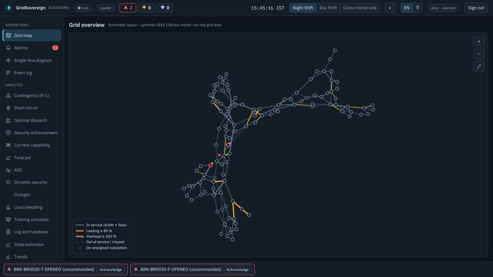

## Contents
1. [What it is](#what-it-is)
2. [Architecture](#architecture)
3. [How data flows](#how-data-flows)
4. [How a breaker command is protected](#how-a-breaker-command-is-protected)
5. [Resilience: leader election and failover](#resilience-leader-election-and-failover)
6. [CIM-first: one model drives everything](#cim-first-one-model-drives-everything)
7. [What it does](#what-it-does)
8. [Run it](#run-it)
9. [How the claims are checked](#how-the-claims-are-checked)
10. [What it is not](#what-it-is-not)
11. [Repository map](#repository-map)

## What it is
A control-centre software platform in two layers:

- **SCADA**: collects telemetry from substations, keeps the live picture, raises alarms and lets an authorised operator issue breaker commands, with every action recorded in a tamper-evident log.
- **EMS**: grid analysis on top of SCADA: state estimation, N-1 and N-2 contingency analysis, short circuit, optimal dispatch, security enhancement, corridor limits, forecasting, AGC, dynamic security, outage scheduling, load shedding and a dispatcher training simulator. Results are advisory.

Hard rules it was built under: all code written from scratch (permissive open-source libraries allowed, security envelope first-party), synthetic or public IEEE data only, memory-safe languages on the network edge, AI/ML advisory only with an off switch and an audit record, an ISA-101 style interface with three themes in English and Hindi.

## Architecture

Services are polyglot by design (see [docs/adr](docs/adr)). Ports are those of the local development stack.

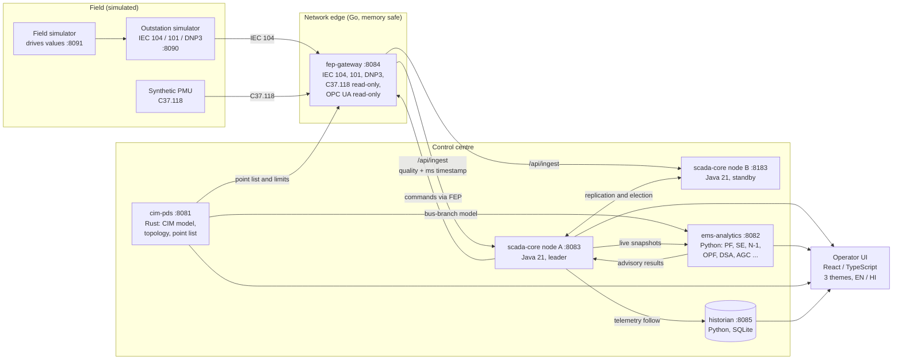

| Service | Language | Role |
|---|---|---|
| `cim-pds` | Rust | CIM node-breaker model store, topology processor, validation, versioned audit chain, model-driven point list and limits |
| `fep-gateway` | Go | Front-end processor: IEC 60870-5-104 and 101, DNP3, IEEE C37.118 (read-only), OPC UA (read-only, no encryption); outstation and PMU simulators; mutual-TLS proxy |
| `scada-core` | Java 21 (JDK only) | Single-writer, event-sourced real-time database; ISA-18.2 alarms with first-out; sequence of events; secured control; active/standby with quorum election |
| `ems-analytics` | Python | Power flow, state estimator, contingency, short circuit, optimal dispatch, security enhancement, corridor capability, AGC, dynamic security, outages, load shedding, training simulator |
| `historian` | Python | Telemetry history, trends, forecasting (SQLite by default, PostgreSQL optional) |
| `ui` | TypeScript / React | ISA-101 style operator interface, 3 themes, Hindi and English |

## How data flows

From a field event to an operator's screen:

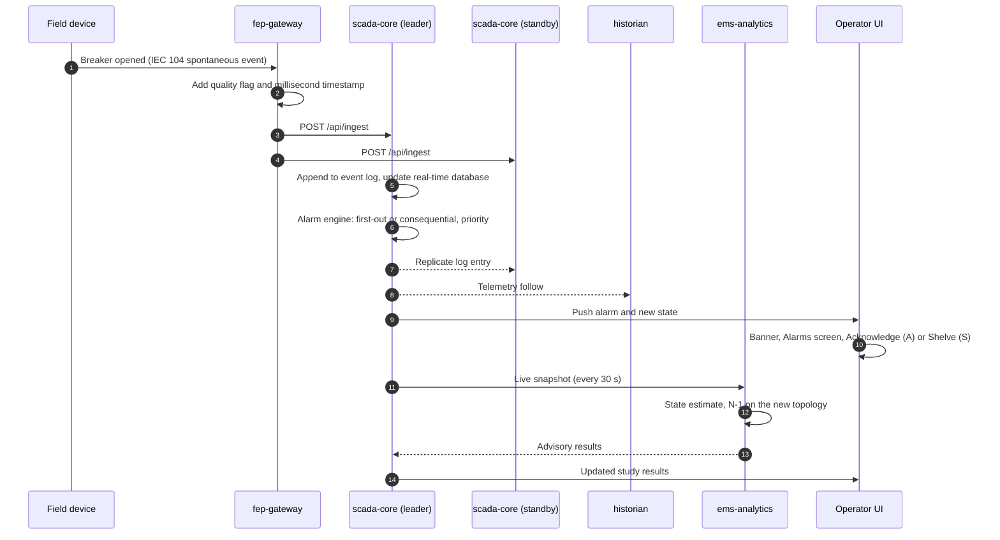

## How a breaker command is protected

Every check below must pass. Any failure refuses the command and is written to the audit log.

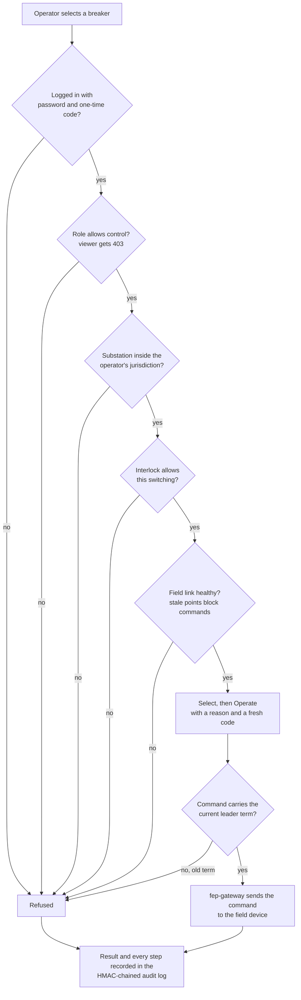

The audit log is chained: each record contains a hash of the one before it, so changing any old record breaks every later link. `System health -> Verify` replays the whole log and checks it.

## Resilience: leader election and failover

With the three-node mode (`GS_QUORUM=1`, Linux only), the core nodes elect a leader by quorum and every election raises a term number (a fencing token).

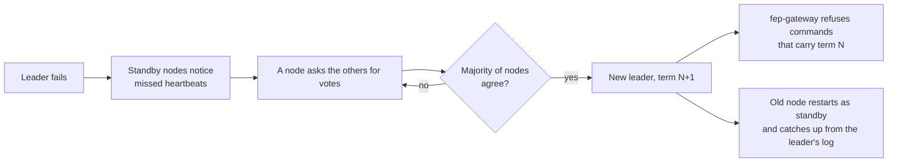

The default two-node stack (used by the Windows build) has a leader and a standby with replication.

## CIM-first: one model drives everything

No application keeps a private network model. Every application reads the model from `cim-pds`, so a change is made once.

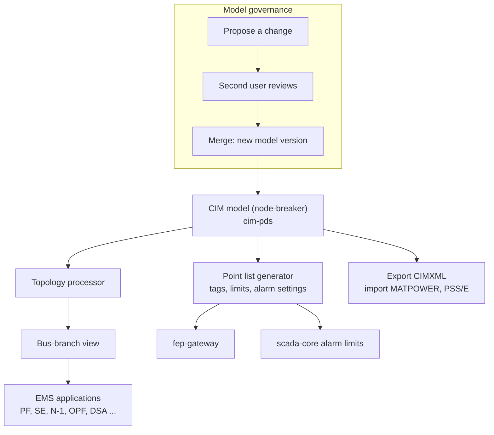

## What it does

| Group | Screens |
|---|---|
| **Operations** | Grid map, Alarms, Single-line diagram, Event log |
| **Analysis** | Contingency (N-1, N-2), State estimator, Short circuit, Optimal dispatch, Security enhancement, Corridor capability, Forecast, AGC, Dynamic security, Outages, Load shedding, Training simulator, Log and handover, Trends |
| **System** | System health, Model manager, Model governance, Migration and exchange |

Screens that suggest or simulate (dispatch, security enhancement, corridors, forecast, AGC, dynamic security, training) are labelled advisory or simulation. They never control equipment.

| | |
|---|---|
| 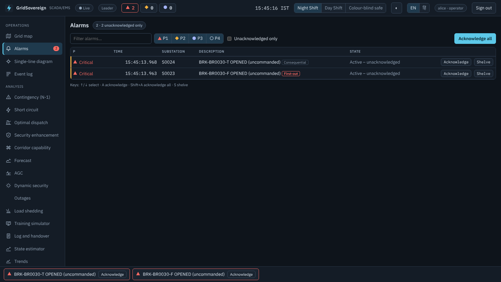 | 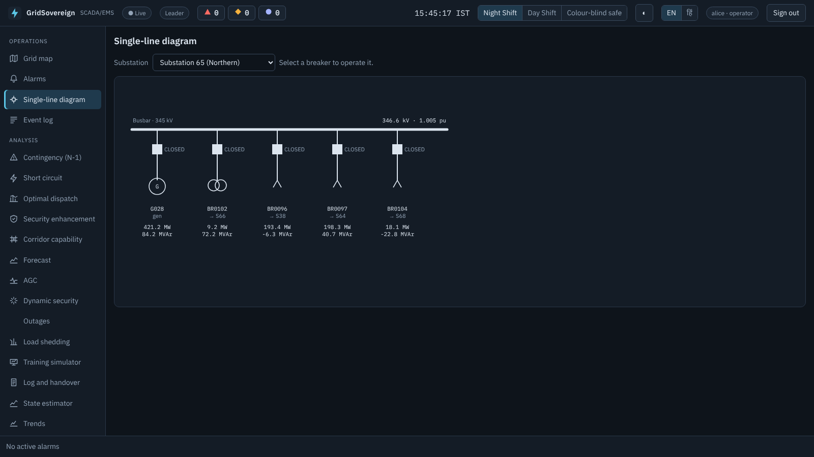 |
| 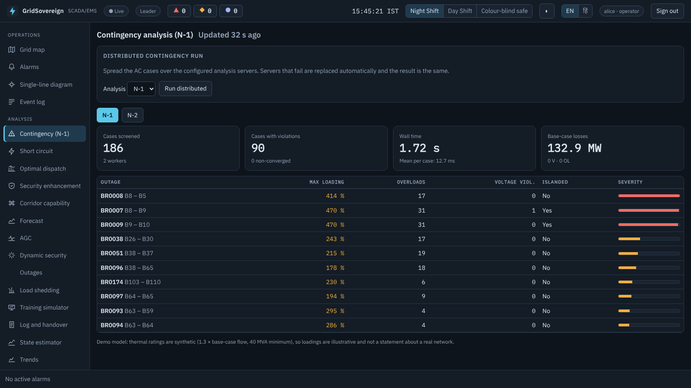 | 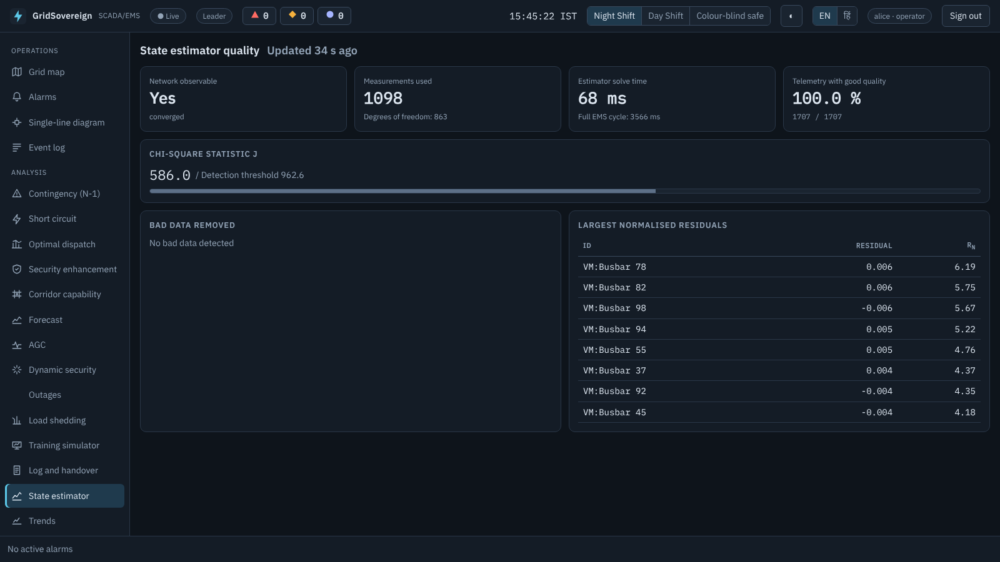 |

Field protocols: IEC 60870-5-104 and 101 (optionally with mutual TLS), DNP3, IEEE C37.118 synchrophasors (read-only), OPC UA (read-only, no encryption, anonymous).

## Run it

### Windows (no Ubuntu)
Install Java 21 and Python 3.12, download `GridSovereign-windows.zip` from the **Releases** page (`windows-demo`), unzip it, then double-click `setup.bat` once and `start-demo.bat` each time. Full steps, helper buttons (`trip.bat`, `code.bat`, `status.bat`, `stop-demo.bat`) and limits are in [docs/WINDOWS.md](docs/WINDOWS.md). The Windows build supports the default two-node mode only.

### Linux (or Windows with WSL)
Needs Java 21, Rust, Go 1.24, Node 22 and Python 3.12 or newer.

```bash
# one-time build
(cd services/cim-pds && cargo build --release)
(cd services/fep-gateway && mkdir -p bin && for c in fep outstation-sim pmu-sim pki mtlsproxy; do go build -o bin/$c ./cmd/$c; done)
(cd services/scada-core && ./build.sh)
(cd ui && npm ci && npm run build)
pip install -r services/ems-analytics/requirements.txt -r services/historian/requirements.txt

# start, look, stop
tools/stack.sh up         # starts every service
tools/stack.sh status
tools/stack.sh down
```

Open <http://127.0.0.1:8083>. Demo users are in `/tmp/gs/coreA/dev-credentials.txt` (alice operator, bob viewer, carol engineer, admin, north). The password follows `demo-password-<user>`, and login needs a one-time code (TOTP) as well.

Make a breaker trip for the demo:

```bash
curl -XPOST localhost:8091/event -H 'Content-Type: application/json' -d '{"trip":["BRK-BR0030-F","BRK-BR0030-T"]}'
```

Optional Linux modes for `tools/stack.sh up`:

| Variable | Adds |
|---|---|
| `GS_QUORUM=1` | Three core nodes with quorum election and fencing |
| `GS_ASYM=1` | Ed25519 service tokens, one key pair per service |
| `GS_MTLS=1` (with `GS_QUORUM=1`) | Mutual TLS between core nodes |
| `GS_TLS=1`, `GS_AUTH=1` | Mutual TLS and command authentication on the field link |
| `GS_DNP3=1`, `GS_IEC101=1` | DNP3 or IEC 101 instead of IEC 104 on the field link |
| `GS_PMU=1` | Synthetic synchrophasor stream |
| `GS_OPCUA=1` | Read-only OPC UA server on 127.0.0.1:4840 |
| `GS_PG=1`, `GS_BUS=1` | PostgreSQL historian, Redis telemetry bus |

A 35-minute guided script is in [docs/DEMO.md](docs/DEMO.md).

## How the claims are checked

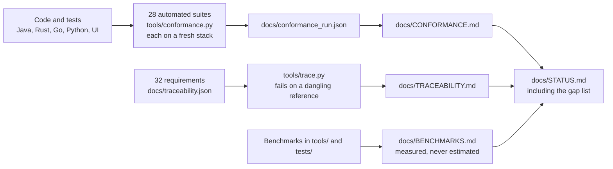

Run the unit and end-to-end suites with `tools/conformance.py`. `tools/trace.py` checks that every requirement points to existing evidence.

## What it is not

- Not certified, and no independent security test (for example by a CERT-In empanelled auditor) or source-code audit has been done.
- ICCP/TASE.2 and IEC 61850 MMS are not built. OPC UA is a reduced, read-only server with no encryption or login.
- All protocol stacks were tested against this project's own simulators and one OPC UA client library, not against vendor equipment or conformance suites.
- Ratings, dynamic parameters and relay settings in the studies are synthetic. Do not use results for protection settings or equipment choices.
- The PMU stream is synthetic and sits outside the CIM model.
- No usability study with real operators, no 7-day soak test, and the EOI scoring weights were not provided (`tools/eoi_score.py` scores nothing until they are filled in).
- The Windows build is tested by one end-to-end suite on a Windows runner. Everything else was run on Linux.

The full gap list and roadmap are in [docs/STATUS.md](docs/STATUS.md).

## Repository map

| Path | Contents |
|---|---|
| `services/cim-pds` | CIM model service (Rust) |
| `services/fep-gateway` | Field gateway, protocol stacks, simulators (Go) |
| `services/scada-core` | Real-time core (Java 21, JDK only) |
| `services/ems-analytics` | EMS applications (Python) |
| `services/historian` | Historian and forecasting (Python) |
| `ui` | Operator interface (TypeScript / React) |
| `data` | IEEE 14-bus and 118-bus models (public test data) |
| `tools` | Stack launchers, end-to-end suites, benchmarks, traceability and conformance tooling |
| `windows` | Double-click launchers for Windows |
| `deploy` | Deployment material |
| `docs` | Architecture, status, benchmarks, threat model, conformance, traceability, SBOM, demo script, usability harness, Windows guide, screenshots |

## Licence and data
No proprietary or foreign SCADA/EMS code is used. The IEEE test networks are public and used only as validation data.
