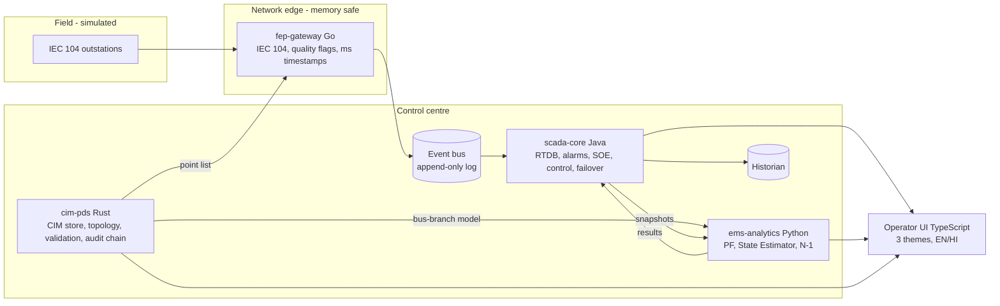

# Architecture

## Principles
1. CIM-first: no application owns a private network model. Every application
   reads the model from cim-pds (node-breaker) or its derived bus-branch view.
2. Independent or integrated: every service exposes an OpenAPI-described HTTP
   API and runs alone against file/JSON fixtures.
3. Event-sourced real-time state: telemetry and operator actions are appended
   to a log so any interval can be replayed deterministically.
4. Security envelope is ours: authN/Z, command authorization, hash-chained
   audit are first-party code.
